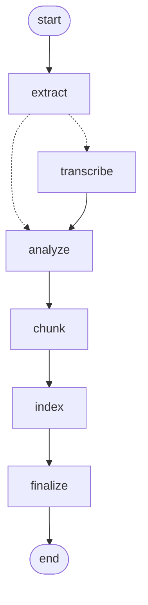
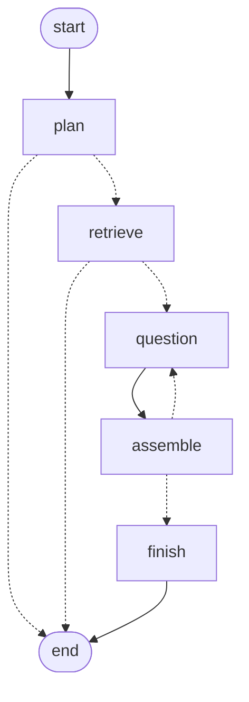
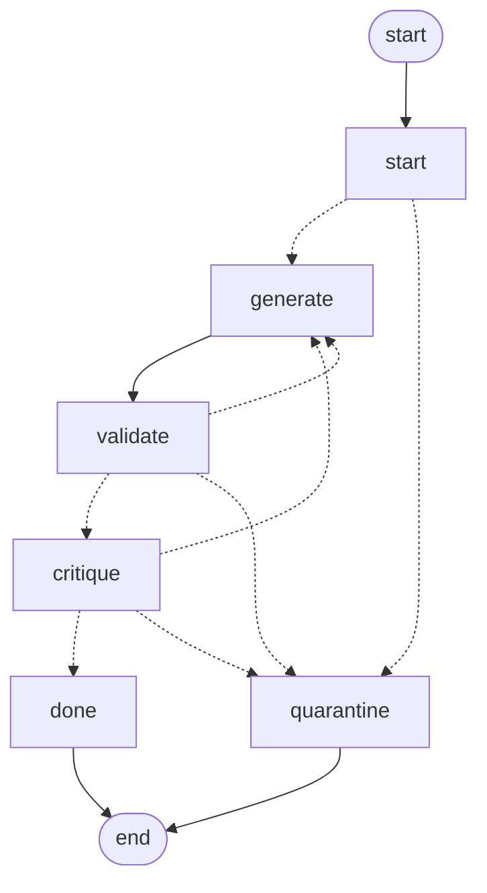

# Nexus

Nexus turns a course's lecture PDFs into a searchable knowledge base and generates multiple-choice quizzes from it. Every question cites the slides it came from. It is built as two [LangGraph](https://github.com/langchain-ai/langgraph) pipelines (ingestion and quiz generation) on Claude Haiku 5.5, Qdrant and a FastAPI + React app.

## Quick start (Docker)

You need Docker and an Anthropic API key. Nothing else (no AWS, no GPU).

```bash
git clone https://github.com/PradHolla/Nexus.git && cd Nexus
echo "ANTHROPIC_API_KEY=sk-ant-..." > .env
docker compose up --build
```

- UI: http://localhost:3000 · API docs: http://localhost:8000/docs
- **Ingest:** on the *Ingestion* tab, enter a course ID (e.g. `CS224`) and drop in one or more lecture PDFs. Each file shows its progress.
- **Quiz:** on the *Quiz* tab, choose the course, the number of questions, a difficulty and (optionally) specific lectures, then describe the quiz you want.

The first start downloads the local embedding model (~180 MB) into `./var/cache`. All runtime state (job DB, checkpoints, caches, uploads) lives in `./var`, and the vectors live in `./qdrant_storage`.

## Local development

```bash
uv sync                                    # Python 3.12 deps
docker compose up -d qdrant                # vector DB only
echo "ANTHROPIC_API_KEY=sk-ant-..." > .env
uv run uvicorn main:app --port 8000 --reload
cd frontend && npm ci && npm run dev       # UI on http://localhost:5173
```

To ingest a whole folder without the UI (copies the files, never modifies them):

```bash
uv run python scripts/ingest_folder.py --course CS224 --dir path/to/pdfs [--exclude old.pdf] [--wipe]
```

Tests are end-to-end only. They run against real Qdrant (in separate test collections), the real local embedding model and the real Anthropic API, and cost under $0.05 per run:

```bash
uv run pytest tests/e2e -v
```

## Architecture

```
PDFs ──▶ Ingestion graph ──▶ Qdrant ──▶ Quiz graph ──▶ SSE stream ──▶ React UI
          (Haiku vision,      chunks +    (Haiku plan,
           local embeddings)  lecture     write, review)
                              summaries
```

### Ingestion: one graph run per PDF



| Node | What it does |
|---|---|
| `extract` | Reads each page's text layer with PyMuPDF. **Collapses "build" slides**: when a slide is just the previous slide plus one more bullet, only the final version is kept, so the index doesn't hold five near-copies. |
| `transcribe` | **One parallel task per page** (LangGraph `Send`). Claude Haiku 5.5 gets the rendered page image plus its text layer and returns clean markdown: equations in LaTeX, tables as markdown tables, a description of every diagram and what it teaches, and a page type (content / navigation / admin). Results are cached on disk, so re-ingesting costs nothing. |
| `analyze` | One Haiku call per lecture: title, a ~200-word summary and topic list. These become the course outline the quiz planner uses. |
| `chunk` | Page-based chunks of up to ~2,500 characters. Text is **never truncated**; long pages are split at paragraph, then sentence boundaries. Admin and navigation pages are kept but flagged, so they never end up in a quiz. Each chunk starts with a `[lecture — pages — slide title]` header and has a stable ID. |
| `index` | Embeds chunks locally (`ibm-granite/granite-embedding-small-english-r2` via fastembed) plus BM25 sparse vectors, and replaces the file's previous points in Qdrant. Re-ingesting the same file gives identical point IDs, so there are no duplicates. Lecture summaries go into a second collection. |

The graph is **checkpointed** (`AsyncSqliteSaver`, `durability="sync"`). If the server dies mid-ingest, it resumes on restart from the last completed step, and pages that were already transcribed aren't sent to Haiku again. Temporary failures (rate limits, timeouts, 5xx) are retried by `RetryPolicy`. A page whose vision call fails permanently falls back to its plain text layer; error text never gets into the data.

### Quiz generation



Each `question` node runs this subgraph, one per question and in parallel:



| Step | What it does |
|---|---|
| `plan` | Haiku reads the professor's request and the **course outline** (every lecture's summary and topics) and plans one slot per question, plus 2 reserves. Each slot has a distinct concept, its target lecture(s), a search query and a difficulty. Broad requests are spread across lectures instead of clustering on one. |
| `retrieve` | Hybrid search (dense + BM25, fused with RRF) per slot, restricted to the course, the slot's lectures and quiz-eligible chunks. Each question's main excerpt is unique, so no two questions rest on the same slide. |
| `generate` | Haiku writes one question from its excerpts (labelled C1–C3) and cites the ones that support the answer. |
| `validate` | Plain code: exactly 4 distinct options, a valid answer index, citations that resolve. Then it **shuffles the options**, so the correct answer's position is random. |
| `critique` | A second Haiku call reviews the question **against the text of the excerpts it cites**: is the answer supported, is exactly one option correct, are the distractors plausible, does the question leak the answer. It approves, asks for a revision (up to 2) or rejects. Rejected questions go to a visible quarantine list with the reason; they never silently disappear. |
| `assemble` | One Haiku call flags duplicate questions across the quiz. If the quiz is short, one top-up round runs from the reserve slots (a LangGraph `Command` back to `question`). |
| `finish` | Emits the final quiz with sources (lecture, pages) and token cost. |

Progress streams to the UI as server-sent events via LangGraph's custom stream mode, including events from inside the subgraphs.

### Why these choices

- **Vision on every page, not OCR.** I first used PyMuPDF4LLM with Tesseract OCR. On the Transformers lecture it turned `E = QKᵀ` into `E=QK!`, dropped the complexity column (`O(n²·d)` vs `O(n·d²)`) from a table, and filled chunks with OCR noise from photos. Deciding *which* pages need vision didn't work either: a "fewer than 300 characters" rule sent title slides to vision and skipped most diagrams. Transcribing every page with Haiku 5.5 fixed equations, tables and diagrams together, for about $0.03 per lecture, paid once.
- **Lecture summaries at ingestion.** A quiz over "the whole course" needs to know what the course contains. The old planner only saw a few retrieved chunks and cited 2 of 25 files on average. Now it plans from the outline.
- **A critic that sees the cited text.** The only quality bar I optimized for is groundedness: every question must be traceable to the slides. The reviewer judges each question against the excerpts it cites, not its own knowledge.
- **Local embeddings.** They remove the AWS dependency, so the only key needed is Anthropic's. Our longest chunk is ~620 tokens, well within the model's input limit. The whole course embeds in about a minute on a laptop CPU.
- **LangGraph** makes the control flow explicit (parallel fan-out, revise loops, top-up rounds) and gives retries, checkpointing and streaming without hand-written orchestration.

### What didn't work

- **OCR and "low text → vision" rules** (see above).
- **Embedding similarity alone for duplicate detection.** Real near-duplicates scored 0.78–0.83 and unrelated pairs 0.79, so a threshold can't separate them. The evaluation and the pipeline use an LLM check instead.
- **Fully exclusive excerpts per question.** On a small deck, later questions got leftover, off-topic excerpts and were rejected. Only each question's main excerpt is unique now.
- **Better data alone.** Re-running the old quiz pipeline on the re-ingested data barely moved its quality (see below). Its problems were in the pipeline design.

## Evaluation

`eval/run_quiz_eval.py` sends 8 fixed quiz requests (44 questions in total: broad, topic-focused, single- and multi-lecture, keyword-driven) to the live API. It checks structure in code and grades every question with an LLM judge against the cited chunk text. Results are saved in `eval/results/`.

| | Old pipeline, old data | Old pipeline, re-ingested data | **New pipeline** |
|---|---|---|---|
| **Answer supported by cited slides** (judge) | 84% | 86% | **98%** |
| Exactly one correct option (judge) | 98% | 93% | 98% |
| Structurally valid (4 options, answer among them) | 91% | 81% | **100%** |
| Duplicate questions within a quiz | 20.5% | 18.6% | **0%** |
| Correct answer position A/B/C/D | 12/27/5/0 | 13/23/7/0 | 8/12/17/6 |
| Lecture files cited per quiz | 2.25 | 2.75 | 3.25 (5–6 on broad requests) |
| Time per quiz | 111 s | 106 s | **60 s** |
| Cost (44 questions) | (Bedrock) | (Bedrock) | **$0.15** |

```bash
uv run python eval/run_quiz_eval.py --label my-run          # needs the API running on :8000
uv run python eval/run_quiz_eval.py --compare a.json b.json
```

## Honest notes

**Limitations**
- **PDF only.** PowerPoint files need to be exported to PDF first. The brief mentions PPTs, but I dropped PowerPoint to keep a single, well-tested pipeline.
- **Transcription is a model's reading of the slide.** Haiku can misread a dense figure. Nothing re-checks transcriptions against the page beyond spot checks.
- **The judge is also Haiku**, the same model that writes and reviews the questions, so the scores may be lenient. I read a sample of verdicts by hand and agreed with them, but 44 questions is a small sample.
- **Many questions can be answered from general ML knowledge.** The judge flags about 60%. On a standard course like CS224N, "why divide by √d_k" is general knowledge even when it comes straight from the slide.
- **Difficulty is approximate.** Questions planned as "hard" tend to come out medium.
- **Lecture analysis truncates very long decks** (over ~240K characters of transcription) before summarizing. The chunks themselves are never truncated.
- The eval's duplicate check still uses Amazon Titan embeddings (an optional dev dependency) so its numbers stay comparable with the first baseline. The app itself doesn't use AWS.

**What breaks first if the load doubles**
1. **Anthropic rate limits.** Ingestion caps vision calls at 8 in flight per process, but quiz requests each run up to 6 parallel questions with no global limit across requests. Many simultaneous quizzes would hit 429s. Retries absorb short bursts; a shared rate limiter is the fix.
2. **One process.** Ingestion jobs run as background tasks inside the API process, with job state in SQLite. Running several API workers would make each one try to recover the same unfinished jobs. Scaling out needs a real queue and separate workers.
3. **The quiz planner's prompt holds every lecture summary.** That's fine for 20 lectures (~10K tokens), but a 200-lecture corpus would need retrieval over the summaries instead.
4. **CPU embeddings** are serialized behind one lock. Queries take ~20 ms, but heavy ingestion slows concurrent quiz retrieval.

**What I'd build next**
- The AI Tutor (below).
- A human-review step for quizzes (LangGraph `interrupt`), so a professor approves or edits questions before release.
- Math rendering (KaTeX) in the UI; questions already use LaTeX.
- PowerPoint support by converting to PDF in front of the same graph.

## Unbuilt feature: the AI Tutor

The Tutor reuses everything ingestion produces: the chunk collection (hybrid search, page-level sources), the lecture-summary collection, the Haiku helper (`src/llm.py`) and the retry policy. It needs no re-ingestion and no new storage. It would be a third LangGraph graph behind `POST /api/tutor/chat` (SSE), built the same way as the quiz graph:

1. **`route`** (Haiku): rewrite the student's message into a standalone question using the conversation so far, and decide which lectures it concerns. "Week 3" or "the backpropagation lecture" is resolved against the lecture-summary collection: match on `lecture_number`, or on the dense vector of each lecture's summary. A question that names two lectures yields two targets.
2. **`retrieve`**: one parallel `Send` per target lecture, each a hybrid search filtered to that lecture's `file_name` (plus one unfiltered search for questions that don't name a lecture). Retrieving per lecture is what makes cross-lecture questions work: both sides of "how does Week 3 connect to Week 9" are guaranteed to get excerpts, rather than whichever lecture happens to rank higher.
3. **`answer`** (Haiku): answer only from the labelled excerpts, cite them inline (`[C2]`), and say plainly when the course doesn't cover something. The lecture summaries give it the course-level picture, so it can explain *how* two lectures relate, not just restate each one.
4. **`verify`** (Haiku): the same idea as the quiz critic. Check every claim against the cited excerpts; on failure, revise once or remove the unsupported claim. This keeps the Tutor grounded the same way the quiz is.
5. **Memory**: the graph is compiled with the same `AsyncSqliteSaver` checkpointer, with `thread_id` = chat session, so follow-up questions ("can you explain that more simply?") see the conversation history.

The UI would show citations exactly like quiz sources ("Lecture 8 · pp. 47–48"), since every chunk already carries its lecture number and page range.

## Tech stack

- **Backend:** FastAPI, LangGraph 1.2, Anthropic SDK (Claude Haiku 5.5), PyMuPDF, fastembed (granite embeddings + BM25), Qdrant, SQLite (jobs and checkpoints), Python 3.12 with uv
- **Frontend:** React 19, Vite, Tailwind CSS 4
- **Infra:** Docker Compose

## Repository layout

```
main.py                     FastAPI app: ingestion + quiz endpoints (SSE)
src/ingestion/              extract, vision, analyze, chunk, index, graph, runner
src/quiz/                   outline, retrieve, prompts, schemas, graph
src/llm.py                  Haiku structured-output helper
src/embeddings.py           local embeddings
scripts/ingest_folder.py    ingest a folder of PDFs
scripts/ingest_preview.py   dry-run ingestion report (no Qdrant writes)
eval/                       quiz evaluation harness and results
tests/e2e/                  end-to-end tests
frontend/                   React UI
```
